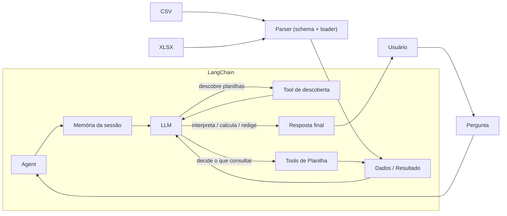

# Arquitetura

## 1. Visão geral

O NLQ responde **perguntas em linguagem natural** sobre dados de planilhas
(CSV e XLSX). O agente (`langchain.agents.create_agent`) decide a estratégia:
prioriza **consulta estruturada** (Pandas) para filtros, contagens e cálculos;
usa `buscar_semantico` (RAG) quando a identificação depende de significado; usa
`consultar_schema` para estrutura; e recorre a `create_json` apenas quando uma
extração ampla é estritamente necessária — com guarda por tamanho.

O agente mantém **memória da sessão**: o histórico de turnos é gravado por
um checkpointer do LangGraph (`InMemorySaver`) e devolvido ao LLM a cada
pergunta. Uma poda de contexto (`ContextEditingMiddleware`) reduz o que é
enviado ao modelo quando o histórico cresce.

O mesmo agente é exposto por **duas interfaces**: a CLI (`src/nlq/main.py`) e uma
**API FastAPI** (`src/nlq/api.py`) com **streaming NDJSON** (incluindo tokens
parciais e raciocínio separado). Ambas compartilham o mesmo checkpointer em
memória; a CLI usa `thread_id="default"` e a API aceita `thread_id` por
requisição.



O projeto é **agnóstico de planilha**: o núcleo não conhece fórmulas nem layouts
específicos. O que ele faz é ler a estrutura tabular e entregá-la — planilhas
semi-estruturadas ou corporativas exigem interpretação que ainda não existe
(ver [`scale_difficulties.md`](scale_difficulties.md)). Detalhes do agente em
[`agent.md`](agent.md).

## 2. Componentes

| Componente            | Onde                                | Papel                                                            | Estado       |
|-----------------------|-------------------------------------|------------------------------------------------------------------|--------------|
| Interface (CLI)       | `src/nlq/main.py`                   | Recebe a pergunta e imprime a resposta (`rich`)                  | **Atual**    |
| API (FastAPI)         | `src/nlq/api.py`                    | Expõe agente via streaming NDJSON (`status`, `token`, `thinking`, `result`, `error`, `ping`): `POST /api/chat`, `DELETE /api/limpar-conversa`, `DELETE /api/limpar-cache`, `GET /health`. Fila + keep-alive + cancelamento cooperativo | **Atual**    |
| Desktop (PyInstaller) | `src/nlq/desktop.py`                | Sobe a API local, escolhe porta livre e abre o navegador         | **Atual**    |
| Agente (langchain)    | `src/nlq/agent/agent.py`            | Orquestra o ciclo LLM ↔ ferramentas via `create_agent`; middleware (`CacheDeChamadas`, `ContextEditingMiddleware`, `ToolCallLimitMiddleware`, `TratarErroDeTool`) | **Atual**    |
| LLM (Groq/OpenRouter) | `src/nlq/agent/agent.py`            | Decide estratégia, interpreta e redige resposta; `session_id` p/ cache de prompt | **Atual**    |
| Prompt de sistema     | `src/nlq/agent/prompts/`            | `system_base.md` + `specific_role.md`                            | **Atual**    |
| Tools                 | `src/nlq/tools/`                    | `create_json`, `goat`, `lista_arquivos`, `consultar_schema`, `buscar_semantico`, `consultar_dados` | **Atual**    |
| Schema (xldetect)     | `src/nlq/data/schema.py`            | Detecta regiões tabulares, cabeçalhos, normaliza schema          | **Atual**    |
| Loader + Cache        | `src/nlq/data/loader.py`            | Carrega CSV/XLSX com cache de schema e registros (invalida por mtime/tamanho) | **Atual**    |
| Embeddings/RAG        | `src/nlq/data/embeddings.py`, `semantic_search.py`, `documents.py` | Gera embeddings (OpenAI), indexa por fingerprint (RAM + disco) e busca semântica | **Atual**    |
| Executor tabular      | `src/nlq/tools/consultar_dados.py`  | Consultas Pandas controladas (sem `eval`) sobre o DataFrame em cache | **Atual**    |
| Parser (CSV)          | `src/nlq/data/loader.py`            | `csv.DictReader` com fallback de codificação                     | **Atual**    |
| Parser (XLSX)         | `src/nlq/data/loader.py`            | Lê via `openpyxl` guiado pelo schema (regiões), reconstrói mesclagens verticais | **Atual**    |
| Memória de sessão     | `src/nlq/agent/agent.py`            | `InMemorySaver` (LangGraph), compartilhada CLI/API               | **Atual**    |
| Métricas              | `src/nlq/agent/metrics.py`          | `PerfCallbackHandler`: duração, tokens e chars por tool          | **Atual**    |
| Warm-up               | `src/nlq/warmup.py`                 | Pré-carrega schema/registros em thread de segundo plano          | **Atual**    |
| Resposta final        | `src/nlq/main.py` e `src/nlq/api.py` | CLI (Painel `rich`) ou streaming NDJSON (`token` parcial + `result`) | **Atual**    |
| Interface (Web)       | `frontend/`                          | Frontend estático com consumo de stream NDJSON, cancelamento, raciocínio dobável e tema; falta a seleção/upload de planilha | **Atual** (upload pendente) |
| Testes                | `tests/`                             | `unittest` das tools, caches, cancelamento, contexto, métricas, paths e desktop | **Atual**    |

A interface web é servida pelo próprio backend HTTP (`src/nlq/api.py` serve a
API e o `frontend/` estático): chat, streaming de tokens, bloco de raciocínio
dobável, loading, exibição de resposta, tratamento de erro, cancelamento,
indicador da planilha consultada, tema claro/escuro e botões de limpar
histórico/caches. Falta a seleção/upload de planilha.

## 3. Fluxo de uma pergunta

1. **Entrada** — o usuário digita a pergunta na CLI, ou o cliente envia
   `POST /api/chat` com `{"message": ..., "thread_id": ...}`.
2. **Agente → LLM** — o agente junta a pergunta ao histórico da thread
   recuperado do checkpointer (podado conforme o gatilho de contexto) e
   encaminha tudo ao modelo.
3. **Decisão** — o LLM escolhe a ferramenta pelo objetivo: `consultar_dados`
   para filtros/contagens/agregações, `buscar_semantico` para significado,
   `consultar_schema` para estrutura, `lista_arquivos` para descoberta.
4. **Consulta** — a tool lê o arquivo (CSV ou XLSX) via parser + schema e
   devolve um resultado compacto (linhas projetadas, totais ou registros
   relevantes).
5. **Volta ao LLM** — o resultado é devolvido ao modelo como contexto.
6. **Resposta** — o LLM interpreta, calcula e redige a resposta final.
7. **Checkpoint** — as mensagens do turno são gravadas na sessão.
8. **Saída** — a resposta é impressa na CLI (Painel com Markdown) ou devolvida
   pela API como `{"response": "...", "planilha": {...} | null}`.

Não há etapa separada de validação nem consulta em linguagem estruturada
intermediária: o LLM escolhe a operação tabular e o Pandas faz o cálculo exato.
O histórico é gerenciado pelo checkpointer, não por código de conversação na
CLI nem na API.

### Fluxo atual e alvo

O fluxo atual combina **seleção local antes do LLM** e **execução determinística**:
`consultar_dados` executa filtros/agregações no Pandas sem ler o arquivo inteiro
para o modelo; `buscar_semantico` (RAG) retorna candidatos relevantes por
significado; `consultar_schema` evita ler registros; e `create_json` só é
chamado quando necessário — com **bloqueio por tamanho** (acima de 20.000
caracteres).

```text
Pergunta
   ↓
 decisão de estratégia (pelo LLM)
   ├─ consultar_dados   (filtros, contagens, agregações, rankings)
   ├─ buscar_semantico  (significado, sinônimos, temas)
   ├─ consultar_schema  (metadados)
   └─ create_json       (extração ampla, só se necessário e dentro do limite)
             ↓
        resultado compacto
             ↓
            LLM → resposta
```

Consultas híbridas usam `refs`: o RAG localiza candidatos (`{"aba", "indice"}`)
e `consultar_dados` restringe a operação exata a esses registros.

## 4. Princípios de projeto

- **Fidelidade** — a resposta deve refletir exatamente os dados; nada de inferir
  valores ausentes (`n/a`, vazio e traço nunca são zero).
- **Confiabilidade** — falhas de execução devem ser explícitas e recuperáveis, não
  silenciosas.
- **Rastreabilidade** — a resposta é acompanhável até o dado de origem
  (`_origem`/`_refs` nos resultados tabulares).
- **Agnóstico de planilha** — o núcleo não pode assumir um layout específico.
- **Extensibilidade** — novas ferramentas e novos modelos entram sem reescrever
  o núcleo.

O agnosticismo se mantém no **parser**, não na identidade: o arquivo de prompt
`specific_role.md` define o escopo do agente e é editável pelo usuário, sem que o
núcleo dependa do seu conteúdo.

## 5. Dívidas técnicas conhecidas

### Payload e contexto

- **`json.dumps` com `indent=2`** — a indentação aumenta o payload enviado ao LLM;
  em XLSX multi-aba o JSON completo pode se aproximar do `max_tokens`. **Mitigação:** `create_json` bloqueia extração acima de 20.000 caracteres e orienta uso de `buscar_semantico`/`consultar_dados`.
- **Ausência de dado não sinalizada no `create_json`** — a tool devolve o dict cru, sem marcar `n/a` ou célula vazia (a sinalização existe em `consultar_dados`).
- **Falhas de leitura** — erros sobem para o LLM (padrão atual). `TratarErroDeTool` devolve o erro ao modelo como `ToolMessage` de status `error`.

### Parser XLSX

- **Regiões tratadas, mas nem tudo** — `xldetect` detecta as regiões e o header;
  `read_workbook` reconstrói **mesclagens verticais** dentro da região e
  descarta linhas totalmente vazias. Ainda não são tratados:
  - mesclagens horizontais (`None`);
  - cabeçalho multinível vira uma única coluna com o nome do primeiro nível;
  - com `data_only=True`, fórmula sem valor em cache devolve `None`;
  - abas ocultas também são lidas.
- Quando o detector não encontra regiões em uma aba, o loader preserva as
  células não vazias com nomes genéricos (`coluna_N`) e emite um aviso.

### Sessão e memória

- **Memória volátil** — `InMemorySaver` guarda em RAM; encerrar o processo
  descarta a sessão.
- **`thread_id` por requisição** — a API aceita `thread_id` no corpo, então há
  várias conversas; a CLI usa `thread_id="default"`. Não há persistência entre
  processos.
- **Caches em RAM** — além do checkpointer, a execução mantém o índice
  semântico `_INDEX_CACHE` e o `_QUERY_CACHE` (`semantic_search.py`), os
  DataFrames `_DF_CACHE` (`consultar_dados.py`) e os caches de schema/registros
  (`loader.py`). `limpar_indices()` e `limpar_cache_dataframes()` liberam essas
  estruturas; `DELETE /api/limpar-cache` as chama (sem autenticação, com `409`
  se houver consulta em andamento) e também apaga os `index-*.pkl` de
  `/tmp/nlq-cache/`. A próxima consulta reconstrói o índice/cache sob demanda.

### Acesso a disco

- **Path com validação** — `buscar_semantico` e `consultar_schema` usam
  `_resolve_path` com `path.is_relative_to(sheets_dir)`. `consultar_dados` e
  `create_json` resolvem sob `data_dir()/<ext>/` e verificam `is_file()`.
- **`ext` acoplado ao layout** — a extensão também nomeia a pasta em `sheets/`.
- **`lista_arquivos`** — lê `sheets/csv/` e `sheets/xlsx/`; remove trechos entre
  parênteses. Não filtra por extensão nem trata pasta ausente
  (`itertools`-style `iterdir()`), o que pode ser aprimorado.

### Agente e configuração

- **Chaves** — `GROQ_API_KEY` é usada para construir o modelo Groq quando
  selecionado; OpenRouter validado via `check_openrouter_key()`. Embeddings
  exigem `OPENAI_API_KEY`.
- **Seleção de modelo** — `usar_groq` (compara `API_SELECT` e validação da chave
  OpenRouter). Logs `[MODELO]` na inicialização. `NLQ_MODEL` sobrepõe a escolha.
- **`requests`** — usado em `agent.py` (declarado via dependências).
- **`check_openrouter_key()`** — uma chamada de rede (timeout 5 s) para
  autodetecção de provider.
- **Skills** — os `SKILL.md` são validados na inicialização (RuntimeError se
  nenhum for encontrado) e listados nos logs; o roteamento efetivo vem das
  descrições das ferramentas e do prompt.
- **Testes** — há suíte `unittest` em `tests/` cobrindo tools, caches,
  cancelamento, poda de contexto, métricas, paths e desktop.

## 6. Direção de evolução

A prioridade arquitetural é **reduzir o volume de dados enviado ao LLM** — em
grande parte já endereçada pelo executor Pandas, pela busca semântica e pela
poda de contexto. O que permanece:

- **aprimorar busca semântica/RAG** — melhor seleção/filtros por aba e
  combinação mais robusta com `refs`;
- **parser para nível 3/4** — mesclagens horizontais e cabeçalhos multinível
  (ver [`scale_difficulties.md`](scale_difficulties.md));
- **validação da resposta** — checagens determinísticas antes de responder
  (ver [`possible_implements.md`](possible_implements.md) §5);
- **persistência de sessão** — checkpointer em disco para sobreviver ao processo
  (§6 de `possible_implements.md`).

AST permanece como possibilidade futura caso o conjunto de operações exija uma
representação intermediária comum. NL2SQL passa a ser um caminho especializado,
adequado principalmente quando a fonte for um banco relacional real ou possuir
relações claras.

Detalhes de evolução em [`possible_implements.md`](possible_implements.md).
